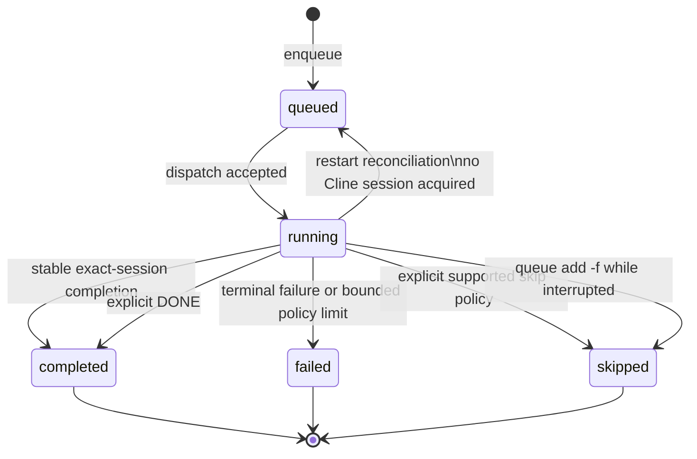
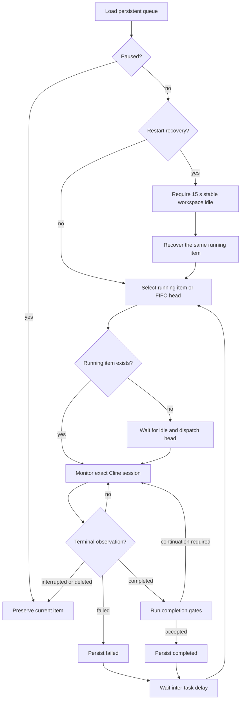
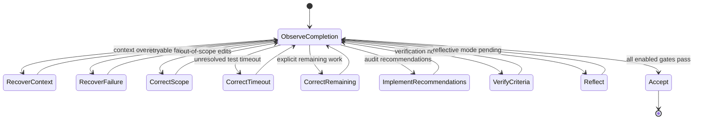

# Flow principles and state machines

This is the authoritative behavioral model for Cline Console queueing, recovery,
and completion scanning. Any change to these rules or transitions must update
this document and its state-machine tests in the same change.

## Flow principles

### Workspace concurrency

Each canonical workspace owns one queue worker, policy monitor, persistence
file, IPC server, and Cline session namespace. Distinct registered workspaces
may run simultaneously; pausing, waiting, recovering, failing, or completing
one queue must not serialize or advance another queue. The singleton daemon is
only a concurrent request router and must delegate activity and status decisions
to the target workspace companion.

1. **One workspace, one ordered flow.** Each canonical workspace owns one
   persistent FIFO, with at most one dispatched queue item.
2. **Cline owns execution truth.** Cline Console owns queue intent and recovery
   metadata; its dispatch record alone never proves execution or completion.
3. **The exact thread owns completion.** Advancement requires stable terminal
   evidence from the exact workspace and Cline session associated with the item.
4. **Continuation stays in-thread.** Remaining work, audit recommendations,
   verification, test-timeout repair, context recovery, reflection, and every
   proposed `new_task` handoff continue the original task.
5. **Persist before consequences.** State and idempotency markers surround
   external dispatch so restart recovery can make deterministic decisions.
6. **Interruption is not completion.** Missing, waiting, closed, or restarted
   execution remains the current item and cannot silently advance the FIFO.
7. **Observations do not rewrite history.** `interrupted` and `closed` are
   display projections; persisted lifecycle states remain stable and auditable.
8. **Policy prompts are idempotent.** Each observation has a stable marker. A
   prompt is handled only after delivery appears in the target transcript.
9. **Bound every wait and retry.** Stability, cooldown, IPC, recovery, and
   policy delivery have explicit bounds and retain durable failure evidence.
10. **Manual authority is explicit.** `DONE` is the only user-confirmed bypass
    of scanner gates and is recorded separately from evidence-based completion.
11. **Task-bound delivery is explicit.** Before any automatic correction,
    verification, recovery, reflection, or handoff message, select the durable
    cline-console-owned session. Serialize selection plus delivery per workspace
    and bound both operations; never rely on whichever Cline panel is active.

## Persisted queue-item state machine

Terminal states are absorbing. Retrying terminal work requires an explicit new
queue record. Recovery of interrupted work occurs while the original record is
still `running`. Runtime mutations are validated against this graph.

An explicit short `queue add -f FILE...` is the operator escape hatch for an
interrupted head: the old record becomes auditable `skipped`, and the supplied
files are inserted ahead of existing waiting work as new tasks without a Cline
resume-session identity. If Cline is genuinely running, `-f` retains its normal
task-file meaning and does not interrupt live work. Positional and `--file`
forms never invoke this override.

`interrupted` is derived when a persisted `running` item lacks live matching
Cline execution, the companion is offline, or Cline is waiting for resumption.
`closed` is derived from `completed + userConfirmedCompletion`. Neither is a
persisted lifecycle state.

## Workspace flow

## Completion-policy state machine

Gates run in deterministic priority order. A gate that emits a continuation
returns control to Cline and restarts observation of the same session; later
gates do not run on that completion claim.

The new-task policy monitor runs alongside this machine. It selects the exact
requesting session, sends a marked same-thread continuation, confirms that its
marker or compatible instruction appears after the handoff, and only then saves
the handoff marker as handled. Three semantically identical handoffs from one
session trip a persisted circuit breaker: the scanner compacts that thread once,
delivers one final continuation, and suppresses later identical handoffs. This
retains the current queue item without creating an unbounded prompt loop.

Completion verification is a mandatory same-thread gate when enabled. The first
otherwise acceptable completion emits `completion_verification_requested` and
persists that completion marker after delivery. A later completion is accepted
only when it is newer than that marker and contains no detected implementation
activity. If the verification pass changes implementation, the scanner emits
`completion_reverification_requested`, advances the marker, and repeats the
gate. Only a newer read-only verification pass emits `completion_verified` and
permits reflection or final queue completion. The explicit CLI `DONE` override
remains the sole operator-authorized bypass.

## Rules for extending the flow

- Add a state only for durable authority, not a transient UI observation.
- Add a transition only with a trigger, persistence point, recovery behavior,
  display projection, and automated test.
- Every new scanner gate declares its priority and stable idempotency marker.
- A gate may retain the current item; it may not dispatch a successor.
- Ambiguous evidence preserves the running item and exposes the ambiguity.
